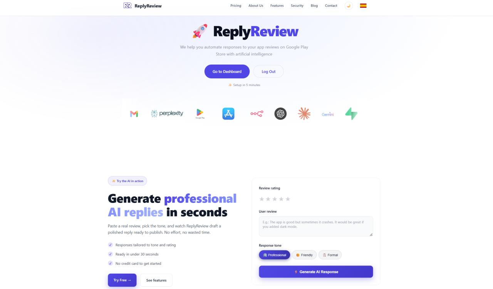
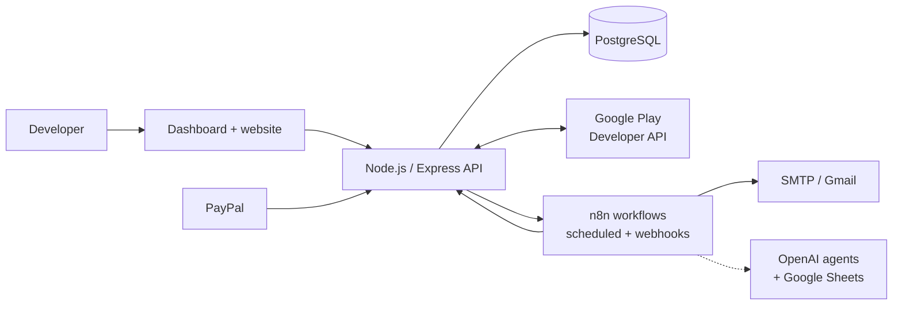
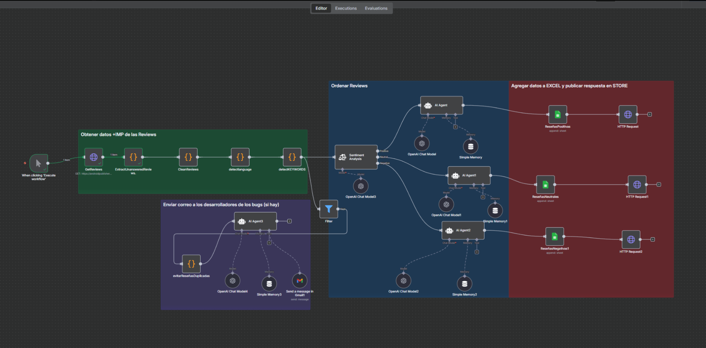
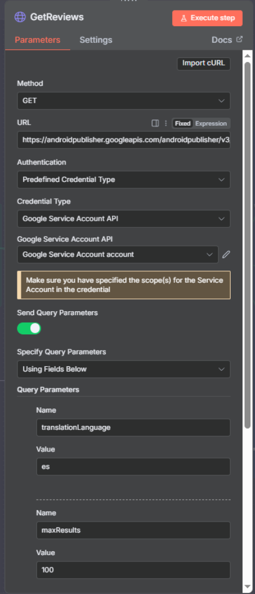
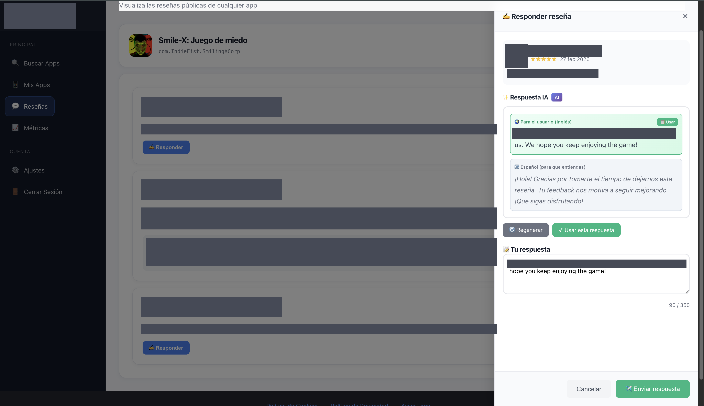
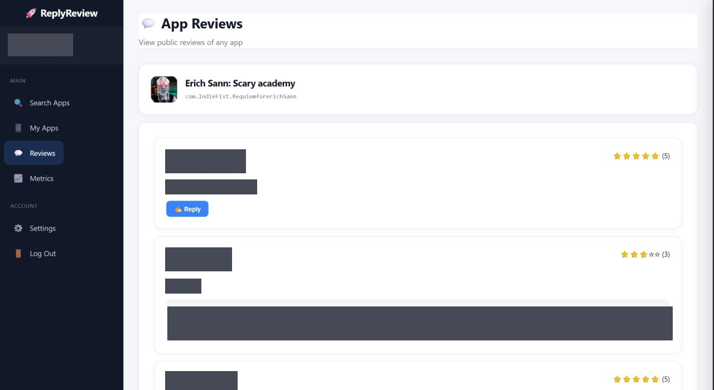

# ReplyReview — Review Automation & Analytics Platform

> Automates the monitoring, analysis and answering of Google Play reviews for app developers, using **n8n**, a Node.js API and PostgreSQL.

**Live product:** [replyreview.es](https://replyreview.es) · **Status:** real project, currently used by several companies · This is a **documentation repository**: the product's source code, workflows and configuration are private.

---

## Overview

ReplyReview is a SaaS I designed and built for app and game developers who receive reviews in many languages and cannot read and answer them one by one. It connects to Google Play, turns reviews into KPIs and alerts, suggests replies in the reviewer's language and can publish them automatically under strict safety rules. Its main users are indie studios and small publishers.

## Business Problem

- Reviews arrive daily in dozens of languages; replying manually is slow and inconsistent.
- Bug reports and complaints are buried among praise, so problems are noticed late.
- Developers lack a quick, regular view of rating, unanswered reviews and recurring issues.
- Automating replies is risky unless ownership, usage limits and safeguards are guaranteed.

## Solution

| Component | What it does |
|---|---|
| **n8n automation engine** | Scheduled jobs: consolidated summary e-mails with alerts, automatic replies, AI-assisted review analysis, transactional e-mail |
| **Node.js / Express API** | Authentication, review retrieval, metrics, reply sending, business rules, billing webhook |
| **PostgreSQL** | Users, apps and settings, encrypted credentials, activity log |
| **Dashboard** | Reviews, reply assistant, metrics panel, per-app automation switches |
| **Website** | Marketing site, pricing, blog and sign-up in Spanish and English |

## System Architecture

More detail: [docs/architecture.md](docs/architecture.md).

## n8n Automation Engine

n8n is the orchestration layer of the product. The main workflows:

| Workflow | Trigger | What it does |
|---|---|---|
| **Daily Summary** | Scheduled | Reads the apps with the feature enabled, analyses their reviews in JavaScript and sends **one HTML e-mail per user** with KPIs and alerts |
| **Auto Reply** | Scheduled | Finds unanswered reviews, prepares replies and asks the backend to publish them under safety rules, then e-mails an activity report |
| **AI Review Analysis & Reply** | Webhook / manual | Google Play API → JavaScript preprocessing → sentiment routing → OpenAI agents with memory → spreadsheet, reply publishing and a bug alert by e-mail |

*The AI workflow in the n8n editor: data preparation (green), sentiment routing and AI agents (blue), storage and publishing (red), developer alerts (purple).*

## Workflow Deep Dive

- **Fan-out / fan-in.** A single multi-tenant workflow expands every enabled app into items, calls the API per app and regroups results per recipient. Customers are configuration rows, not copies of a workflow.
- **Safe automation.** n8n decides *when*; the backend decides *whether it is allowed* (ownership, opt-in, limits, test mode). Rules cannot be bypassed by editing a workflow.
- **Deterministic first, AI second.** JavaScript Code nodes clean, label and filter data before any model sees it, keeping prompts small and results auditable.
- **Agents with tools.** AI agents with memory per sentiment class and a tool-using agent that sends bug alerts by e-mail.

Full overview: **[docs/n8n-workflows.md](docs/n8n-workflows.md)**.

## Data Processing & Business Logic

- **Hybrid acquisition:** official API plus public store pages, merged into one schema and de-duplicated.
- **Normalisation:** consistent, accent- and case-insensitive text handling across languages.
- **Heuristics in n8n:** sentiment from dictionaries and star ratings, problem detection and alert levels.
- **Rules in the API:** ownership verification, per-app opt-in, usage limits and encrypted credentials.

See [docs/data-pipeline.md](docs/data-pipeline.md).

## Analytics Dashboard

Per-app metrics: total reviews, average rating, replied share, unanswered reviews, positive/negative counts, **critical unanswered reviews**, 1–5★ distribution and top review languages. The API computes them and the browser renders them.

*Reviewer names, usernames and review texts are covered with solid blocks.* More: [docs/dashboard.md](docs/dashboard.md).

## Web Platform

A bilingual (ES/EN) marketing site with pricing, features, legal pages and a blog, plus login/registration and the dashboard, built with HTML, CSS and vanilla JavaScript.

## Technical Challenges

1. **Two incompatible review sources → one schema.** *Challenge:* the official source is replyable but limited; the other has more history but cannot be answered. *Solution:* merge, flag replyable items and de-duplicate. *Outcome:* one consistent list that survives either source failing.
2. **Automatic replies without losing control.** *Challenge:* public replies on a customer's behalf. *Solution:* layered safeguards with the rules in the API and a test mode. *Outcome:* the pipeline can be validated end-to-end safely.
3. **One execution, many customers.** *Challenge:* a workflow per customer does not scale. *Solution:* multi-tenant fan-out/fan-in driven by configuration. *Outcome:* onboarding without touching n8n; one e-mail per user.
4. **Multilingual analysis without an NLP service.** *Challenge:* accents, emoji, many languages. *Solution:* normalisation, multilingual dictionaries and a rating tie-breaker before any AI step. *Outcome:* explainable alerts and leaner AI prompts.

More: [docs/technical-challenges.md](docs/technical-challenges.md).

## Tech Stack

Technologies verified in the project:

| Area | Technologies |
|---|---|
| Automation | n8n (HTTP Request, Code/JavaScript, Schedule, Webhook, Email Send, Google Sheets, Gmail, OpenAI chat models and agents, Sentiment Analysis) |
| Backend | Node.js, Express, PostgreSQL (`pg`), JWT, bcrypt, helmet, express-rate-limit, axios, googleapis, google-play-scraper |
| Frontend | HTML5, CSS3, vanilla JavaScript, JSON-based i18n |
| Integrations | Google Play Developer API, SMTP/Gmail, OpenAI, Google Sheets, PayPal subscriptions |
| Deployment | Linux VPS, Docker (n8n), Nginx, Let's Encrypt |

## My Role

I conceived, designed, implemented and operate ReplyReview. My work covers the automation design in n8n (workflows, Code-node data processing, integrations), the integration of Google Play, e-mail, OpenAI and billing services, the business rules and the product's evolution. I built it using AI coding assistants for parts of the implementation; I direct the design, review the result and run the system in production.

## Project Status

ReplyReview is a real project currently used by several companies. No customer, revenue or performance figures are published here.

## Technical Documentation

- [Architecture](docs/architecture.md)
- [n8n workflows](docs/n8n-workflows.md)
- [Data pipeline](docs/data-pipeline.md)
- [Dashboard & metrics](docs/dashboard.md)
- [Technical challenges](docs/technical-challenges.md)
- [Code example](examples/README.md)

---

*This repository documents the project at a high level. It contains no product source code, workflow exports, credentials, internal endpoints or customer data. Screenshots are sanitised.*
