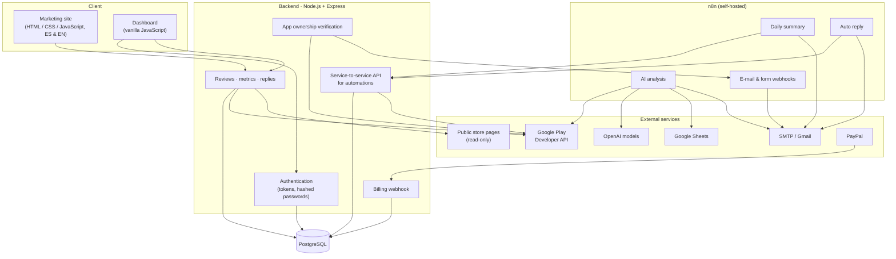

# System Architecture

ReplyReview is a multi-tenant SaaS made of a static web front end, an API, a relational database, a self-hosted n8n automation server and a set of external services. This is a **high-level** description; internal endpoints, schemas and configuration are intentionally omitted.

## 1. Component overview

## 2. Responsibilities

| Layer | Technology | Responsibility |
|---|---|---|
| Web / front end | HTML5, CSS3, vanilla JavaScript, JSON-based i18n | Landing, pricing, features, legal pages, blog, login/registration and the dashboard |
| API | Node.js, Express, `helmet`, `cors`, `express-rate-limit`, `axios` | Authentication, review retrieval, metrics, reply sending, app management, automation support, billing webhook |
| Database | PostgreSQL (`pg`) | Accounts and plans, apps and feature settings, encrypted credentials, activity log |
| Automation | n8n (Docker, self-hosted) | Scheduling, orchestration, data shaping, e-mail delivery, AI analysis |
| External | Google Play Developer API (`googleapis`), `google-play-scraper`, SMTP/Gmail, OpenAI, Google Sheets, PayPal | Review data, reply publishing, notifications, billing |

## 3. Key design decisions

1. **n8n owns *when*, the API owns *whether*.** Scheduling, fan-out and notifications live in n8n; every rule that can publish something to a store lives in the API, so no workflow can bypass it.
2. **Configuration drives automation.** Each app has per-feature settings that the dashboard toggles and the workflows read. Onboarding a customer needs no workflow edit.
3. **Hybrid review source.** The official API provides what is needed to reply; public pages add more history. The API merges and de-duplicates both and marks which reviews can be answered.
4. **Ownership verification before any write.** A user must prove control of an app before replies can be published for it.
5. **Credentials encrypted at rest** with an authenticated cipher.
6. **Defence in depth.** Security headers, an origin allow-list, rate limiting, token-based authentication, role-restricted admin area and hashed passwords.

## 4. Data model (conceptual)

The main entities are **users** (with a plan), **apps** (belonging to a user, with a verification state and feature settings), **stored credentials** (encrypted) and an **activity log** of replies. Review content itself is fetched on demand and is not stored by the API.

## 5. Where each calculation happens

| Calculation | Where |
|---|---|
| Usage counts and "which apps to process today" | PostgreSQL queries |
| Merging and de-duplicating review sources | API |
| Dashboard KPIs | API computes, browser renders |
| Sentiment, problem detection, alert levels, e-mail reports | n8n Code nodes |
| Reply suggestion in the dashboard | API |
| AI analysis and drafting | n8n (OpenAI agents) |
