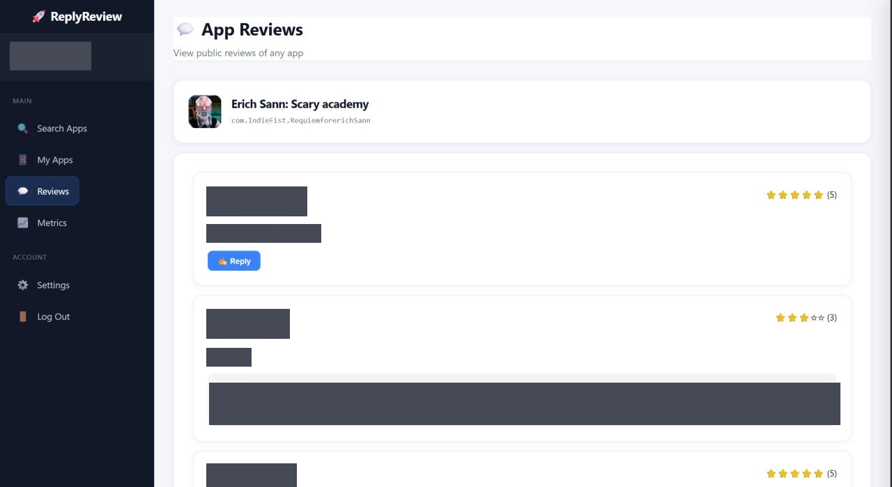
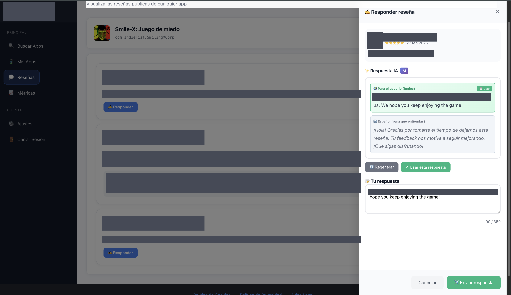

# Analytics Dashboard

The dashboard is a single authenticated page built with vanilla JavaScript and served from the same domain as the API. Reviewer names, usernames and review texts in the captures are covered with solid blocks.

## 1. Sections

| Section | What it does |
|---|---|
| **Search Apps** | Finds Google Play apps by name |
| **My Apps** | Saved apps, the connection/verification wizard, per-app switches for *auto-reply* and *daily summary* |
| **Reviews** | Reviews of the selected app, with a *Reply* button where a reply is possible |
| **Metrics** | KPI cards, review analysis, star histogram and language split |
| **Settings** | Profile, review language, alert keywords, plan, admin area (admins only) |

## 2. Reply assistant

*Reply* opens a side panel with the review, a suggested reply and an editable text area limited to **350 characters** (Google Play's reply limit), with a live counter. When the reviewer's language differs from the developer's, two versions are shown: the one that will be published and one in the developer's own language so they understand what is being sent. The developer can regenerate, edit and send.

## 3. Metrics panel

| Block | Metric |
|---|---|
| Overview | Total reviews · average rating · replied share · unanswered reviews |
| Analysis | Positive (4–5★) · negative (1–2★) · **critical unanswered** (low rating without reply) |
| Distribution | 1–5★ histogram with counts, percentages and colour bands |
| Languages | Share of the most common reviewer languages |

The panel states whether the data comes from the official API or from public pages, so the user knows what the sample is based on.

**Not implemented:** rankings, time-series charts, period filters and exports. They are not described because they do not exist in the product.

## 4. E-mail dashboard

The daily summary e-mail works as a push dashboard: per app, KPI tiles (total, positive, negative, average rating), an alert badge, the most frequent problem keywords and a list of flagged reviews, with a link back to the dashboard. See [n8n-workflows.md](n8n-workflows.md).

## 5. Where the work happens

| Layer | Work |
|---|---|
| PostgreSQL | per-app settings, usage counts |
| API | metric calculation, review merge, rule enforcement |
| n8n | sentiment/problem heuristics, alert levels, e-mail reports |
| Browser | rendering, percentages, bar widths, language switching (ES/EN), character counter |
