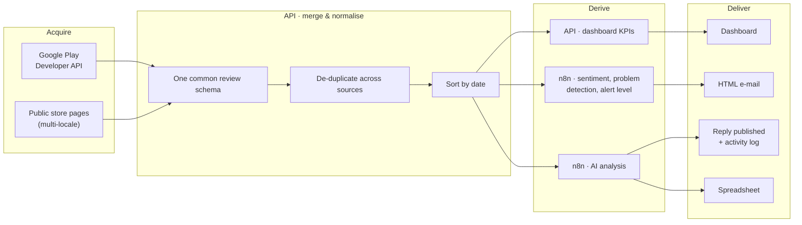

# Data Pipeline

How review data flows through ReplyReview: acquisition → normalisation → derivation → delivery. Concrete rules and parameters are omitted on purpose.

## 1. Acquisition

- **Official API:** returns reviews with the identifiers needed to reply, the review text (original and translated), rating, date, reviewer language and any existing developer reply.
- **Public store pages:** read-only, queried in several locales to widen coverage across languages and history.

Each source is isolated, so the pipeline keeps working if one fails.

## 2. Normalisation and validation

- Both sources are mapped to a **single schema**, so every consumer (dashboard, automations) sees the same shape.
- Dates from different formats are converted to a standard form and invalid ones are discarded.
- The two sources do not share identifiers, so duplicates are removed with a **business key** derived from the review content; official reviews take priority.
- Text is normalised (case, accents, whitespace) before matching.
- Write operations validate required fields, ownership and permissions.

## 3. Transformation

| Step | Where | Description |
|---|---|---|
| Review KPIs | API | totals, average rating, replied share, star distribution, positive/negative counts, critical unanswered reviews, language split |
| Sentiment | n8n | multilingual dictionary matching with the star rating as tie-breaker |
| Problem detection | n8n | keyword and pattern matching across several languages |
| Alert level | n8n | a small number of levels summarising how many problem reviews an app has |
| Grouping | n8n | fan-out per app, fan-in per recipient |
| Reply suggestion | API | language- and rating-aware suggestion |
| Classification + drafting | n8n | sentiment routing and OpenAI agents |

## 4. Storage

PostgreSQL stores accounts, per-app settings, encrypted credentials and the reply activity log. Review content is **fetched live** rather than copied into the database, which keeps data current and avoids holding third-party data. The AI workflow records its analysed reviews in a spreadsheet.

## 5. Visualisation

Dashboard (reviews, reply assistant, metrics), e-mail reports generated by n8n, and the spreadsheet. See [dashboard.md](dashboard.md).

## 6. Known limitations

- Dashboard metrics describe a **recent sample** of reviews, not the full history.
- Sentiment and problem detection are heuristics: explainable and cheap, but not a trained model.
