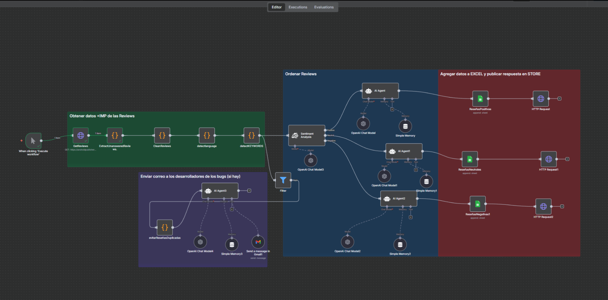
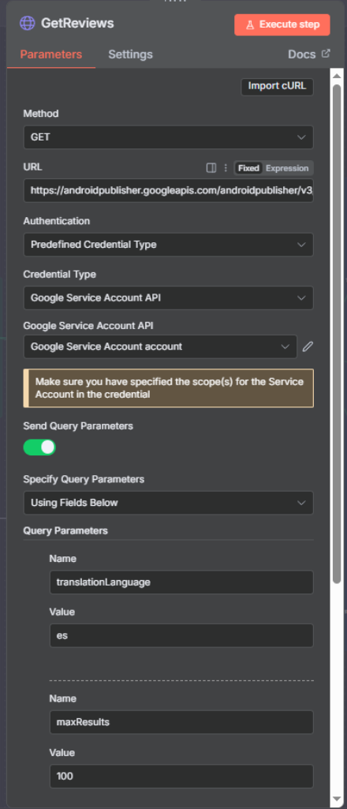
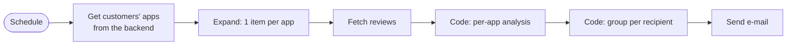
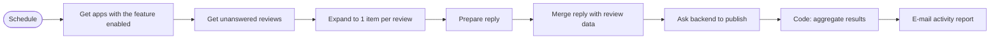

# n8n Workflows — Technical Overview

ReplyReview uses **n8n as its automation and orchestration layer**. This document explains how the workflows are designed and which techniques they demonstrate. Implementation details (exact rules, thresholds, dictionaries, prompts, endpoints and credentials) are intentionally **not** published: this repository documents the *design*, not the private implementation.

## 1. The workflows at a glance

| Workflow | Trigger | Purpose |
|---|---|---|
| **Daily Summary** | Scheduled (daily) | One consolidated e-mail per user with review KPIs and problem alerts for all their apps |
| **Auto Reply** | Scheduled (daily) | Finds reviews still unanswered, prepares a reply, submits it through the backend under safety rules, and e-mails an activity report |
| **AI Review Analysis & Reply** | Webhook / manual | Reads reviews from the Google Play API, prepares the data, classifies sentiment, and uses AI agents to draft replies, log results in a spreadsheet and alert developers about bugs |
| **Transactional e-mail** | Webhook (called by the backend) | Sends system e-mails (for example, account/app verification messages) so the application code holds no mail credentials |
| **Website forms** | Webhook (called by the site) | Receives contact-form submissions |

The workflows are running in production according to the project owner.

## 2. AI Review Analysis & Reply

The editor groups the workflow in four coloured areas:

| Area | What it does |
|---|---|
| **1 · Get and prepare reviews** (green) | An HTTP Request node calls the Google Play Developer API with a service-account credential. A chain of **Code (JavaScript) nodes** keeps only unanswered reviews, cleans the text, detects the review language and flags reviews that mention problems |
| **2 · Sort reviews** (blue) | A **Sentiment Analysis** node splits reviews into *positive / neutral / negative* branches. Each branch has its own **AI Agent** with a chat model and short-term memory, so tone and content adapt to the sentiment |
| **3 · Store data and publish** (red) | Results are appended to a spreadsheet per sentiment, and a reply is published through an HTTP request |
| **4 · Alert developers** (purple) | Reviews that signal a possible bug go through a filter and a de-duplication step, then an AI agent with an e-mail tool writes a summary for the development team |

The first node, configured with a Google service account (no secrets are shown):

**Why this design is interesting**

- **Deterministic preprocessing before the AI.** Cleaning, language detection and flagging are done with plain JavaScript, so the prompts stay small, cheaper and easier to audit.
- **Routing by class.** Splitting by sentiment allows different instructions per branch instead of one generic prompt.
- **Agents with tools.** The alert branch uses an agent that can send an e-mail, not just generate text.
- **Persistence.** Every analysed review is recorded in a spreadsheet for later analysis.
- **De-duplication** so developers are not notified twice about the same review.

## 3. Daily Summary (scheduled, multi-tenant)

**Idea.** Instead of one workflow per customer, a single workflow asks the backend which apps have the feature enabled and processes all of them. Onboarding a customer is a configuration change, not a workflow edit.

**Techniques demonstrated**

- **Fan-out / fan-in:** items are expanded per app for the API calls and regrouped per recipient, so each user receives one message however many apps they own.
- **Paired-item lookups** to recover context after an HTTP node.
- **JavaScript data processing in Code nodes:** date handling, text normalisation, classification and aggregation.
- **Safe HTML generation** with escaping of third-party text.
- **Alert levels** that summarise the state of an app so the reader knows at a glance whether anything needs attention.

## 4. Auto Reply (scheduled, with safeguards)

**Principle: n8n decides *when* and *for whom*; the backend decides *whether it is allowed*.** n8n never publishes directly to the store. It calls the backend, which enforces ownership verification, the per-app opt-in, usage limits and a **test mode** that runs the full pipeline without publishing anything. Putting the rules in one place makes them testable and impossible to bypass by editing a workflow.

**Other techniques:** service-to-service authentication, idempotent selection (only unanswered reviews are processed), a per-run cap, safe JSON construction from untrusted text, and a per-user activity report with sent / test / error counters.

## 5. Transactional e-mail and forms (webhooks)

The backend and the website call n8n webhooks to send e-mails and receive form submissions. This keeps mail credentials out of the application code and lets e-mail templates change without redeploying the API.

## 6. How the reply text is produced

ReplyReview has two distinct mechanisms, documented separately to avoid overstating either:

1. **Dashboard reply assistant:** the backend suggests a reply in the reviewer's language from curated, language-specific templates selected by star rating, together with a version in the developer's language so the developer understands what will be sent.
2. **n8n AI workflow:** AI agents (OpenAI chat models) draft replies and summaries from the reviews of each sentiment class.

## 7. Code example

A small, generic excerpt of the n8n patterns above is in [examples/](../examples/README.md).

## 8. What these workflows demonstrate

- Orchestrating a multi-tenant process driven by configuration data.
- Fan-out / fan-in and paired-item handling in n8n.
- JavaScript data processing for text, dates and aggregation.
- Combining deterministic processing with LLM agents (routing, memory, tools).
- Designing safe automation: separation of scheduling and business rules, test mode, quotas, ownership checks.
- Integrating HTTP APIs, SMTP/Gmail, Google Play, Google Sheets and OpenAI.
